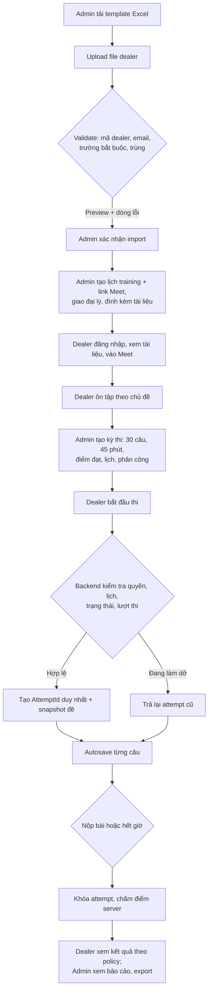
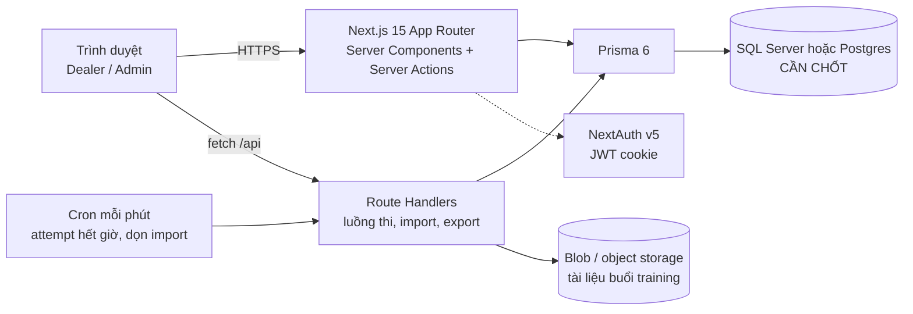

# 01 — Tổng quan, phạm vi và kiến trúc

## 1. Mục tiêu

Website responsive để đại lý Kymdan:

1. Tham gia buổi training (họp giữa công ty và đại lý) qua link Google Meet, xem tài liệu đính kèm từng buổi.
2. *(Bỏ 2026-10-13: "khóa đào tạo" — công ty không đào tạo theo khóa, xem [09](09-cau-hoi-mo-rui-ro.md) Q19.)*
3. Ôn tập câu hỏi không giới hạn.
4. Dự thi chính thức (30 câu / 45 phút / 1 lượt).

Hệ thống phải lưu bài làm an toàn, chấm điểm phía server và chịu được **1.000 người thi đồng thời** theo kịch bản nghiệm thu.

## 2. Phạm vi MVP

### Trong phạm vi

| Module | Nội dung |
|---|---|
| Người dùng & đại lý | CRUD, khóa/mở tài khoản, import Excel/CSV có preview, kiểm tra lỗi, xuất dòng lỗi |
| Lịch training | Buổi họp Google Meet (nội dung, người trình bày, giờ, link), giao đại lý (tất cả / khu vực / danh sách mã), tài liệu đính kèm buổi (link hoặc file), điểm danh khi bấm Tham gia. Không có khóa học |
| Ngân hàng câu hỏi | Chủ đề (có thể phân cấp), câu hỏi, lựa chọn, đáp án, giải thích, trạng thái Draft/Published/Archived |
| Ôn tập | Không giới hạn lần; hiện đáp án/giải thích theo cấu hình |
| Thi chính thức | 30 câu, 45 phút, 1 lượt hợp lệ; autosave, khôi phục sau mất kết nối, nộp bài, hết giờ, chấm server |
| Quản trị kỳ thi | Lịch mở/đóng, điểm đạt, random, chính sách hiện điểm/đáp án, cấp lại lượt có lý do |
| Báo cáo | Kết quả, tiến độ, tỷ lệ đạt; export CSV/XLSX |
| Vận hành | Audit log, monitoring, backup, kiểm thử tải |

### Ngoài phạm vi

- Tự xây hội nghị video (chỉ tích hợp link Google Meet).
- Giám sát thi bằng webcam/AI, nhận diện khuôn mặt, lockdown browser.
- App iOS/Android native, thanh toán, chứng chỉ điện tử nâng cao.
- Tích hợp ERP/CRM/SSO phức tạp.

## 3. Vai trò và phân quyền

Chỉ có **2 vai trò**. Không có vai trò Trainer, Report Viewer hay Auditor. Người trình bày trong Google Meet **không** là vai trò đăng nhập.

| Vai trò | Quyền | Giới hạn |
|---|---|---|
| Quản trị viên | Toàn quyền nghiệp vụ: đại lý, tài khoản, vai trò, lịch Meet + tài liệu, ngân hàng câu hỏi, kỳ thi, cấp lại lượt, báo cáo, export, audit log | Thao tác nhạy cảm (cấp lại lượt, đổi quyền, chỉnh kết quả, import, publish đề) bắt buộc ghi audit log |
| Đại lý | Xem lịch training + tài liệu được giao, vào Google Meet, ôn tập, thi chính thức, xem kết quả được phép | Chỉ thấy dữ liệu của chính mình; không thấy đáp án trước thời điểm công bố |

## 4. Luồng nghiệp vụ chính

## 5. Kiến trúc

Spec gợi ý ASP.NET Core + SQL Server, nhưng dự án **dùng stack của TrackMyGoal** (Next.js 15 + Prisma 6 + NextAuth v5 + shadcn/ui). Chi tiết ở [10-cong-nghe.md](10-cong-nghe.md).

| Thành phần | Lựa chọn | Lý do |
|---|---|---|
| Ứng dụng | Một project Next.js chứa cả UI và API | Giống TrackMyGoal; không tách backend riêng |
| CRUD quản trị | Server Actions | Pattern sẵn có của TrackMyGoal |
| Luồng thi | Route Handlers (`app/api/**`) | Server Action từ một client chạy tuần tự, ID đổi mỗi build → không hợp autosave và k6 |
| Auth | NextAuth v5 Credentials, session JWT trong cookie HttpOnly | Giống TrackMyGoal |
| Job định kỳ | Vercel Cron (hoặc cron hệ thống nếu tự host) gọi Route Handler bảo vệ bằng secret | Kết thúc attempt quá hạn; lazy check vẫn là lớp chính |
| Cache | Không cần cho MVP | Tải ghi chỉ vài chục req/s (xem [07](07-kiem-thu-tai.md)) |
| File | Blob/object storage + URL có thời hạn | DB chỉ lưu metadata |

### Nguyên tắc kiến trúc bắt buộc

- Ứng dụng **stateless**; không giữ trạng thái bài thi trong memory của một instance (serverless có thể chạy nhiều instance song song và khởi động lại bất kỳ lúc nào).
- **Server là nguồn thời gian duy nhất**; client chỉ hiển thị countdown dựa trên `deadlineAtUtc` + độ lệch đồng hồ đo được.
- Mọi ràng buộc nghiệp vụ quan trọng (1 lượt thi, không ghi trùng câu trả lời) phải được enforce ở **DB + transaction**, không chỉ ở frontend.
- Không bao giờ gửi `IsCorrect` / đáp án đúng xuống client trong lúc thi.
