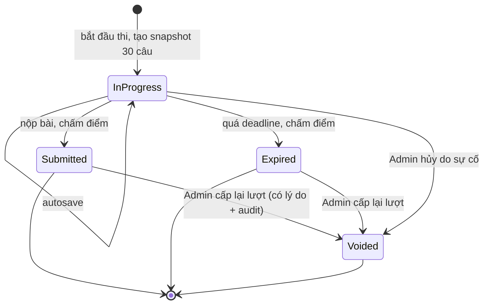

# 02 — Quy tắc nghiệp vụ thi (Exam Engine)

Đây là phần rủi ro cao nhất của hệ thống. Mọi quy tắc dưới đây phải có test tự động (unit + integration) trước khi nghiệm thu.

## 1. Bảng quy tắc gốc (EX-01 … EX-12)

| ID | Quy tắc | Hành vi bắt buộc | Cách hiện thực đề xuất |
|---|---|---|---|
| EX-01 | Cấu hình đề | Mỗi kỳ thi chính thức sinh/cấp đúng 30 câu; không đủ câu Published thì không cho mở kỳ thi | Kiểm tra khi chuyển kỳ thi sang trạng thái Open và lại lần nữa khi tạo attempt |
| EX-02 | Thời lượng | 45 phút tính theo UTC server từ lúc attempt tạo thành công | `DeadlineAtUtc = StartedAtUtc + DurationMinutes`, tính trong cùng transaction tạo attempt; xem mục 4 về giới hạn bởi `Exams.EndsAtUtc` |
| EX-03 | Một lần thi | Unique constraint ở DB cho (ExamId, DealerId) với lượt chính thức được tính | Filtered unique index — **schema.sql hiện chưa có**, xem [04](04-co-so-du-lieu.md#2-lỗ-hổng-so-với-spec) |
| EX-04 | Khôi phục | Đang làm dở và còn giờ → đăng nhập lại tiếp tục cùng AttemptId | `POST /exams/{id}/attempts` trả 200 + attempt cũ nếu có attempt `InProgress` còn hạn |
| EX-05 | Hết giờ | Backend đánh dấu hết giờ, khóa bài, chấm theo câu trả lời đã lưu | Worker quét + kiểm tra "lazy" ở mọi request chạm vào attempt |
| EX-06 | Autosave | Mỗi thay đổi gửi API; UI chỉ hiện "đã lưu" sau phản hồi thành công | Trạng thái per-câu: `saving` / `saved` / `error` |
| EX-07 | Retry | Save/submit dùng idempotency key hoặc version để retry không tạo dữ liệu trùng | Save: upsert theo `(AttemptId, AttemptQuestionId)` + `clientSeq`; Submit: idempotent theo trạng thái attempt |
| EX-08 | Chấm điểm | Chấm ở backend; đáp án không gửi về client trước khi được phép | Chấm từ `SnapshotJson`, không đọc lại `QuestionOptions` hiện hành |
| EX-09 | Cấp lại lượt | Yêu cầu lý do, người thực hiện, thời điểm, log trước/sau | Transaction: void attempt cũ + ghi `AuditLogs` |
| EX-10 | Điểm/đáp án | Cấu hình kỳ thi quyết định hiện điểm ngay, hiện đáp án, hay công bố sau khi kết thúc kỳ thi | `ShowScorePolicy`, `ShowAnswerPolicy` |
| EX-11 | Random | Nếu trộn câu, lưu snapshot câu hỏi và thứ tự cho từng attempt | Luôn snapshot (kể cả đề cố định) để chống sửa câu hỏi giữa kỳ thi |
| EX-12 | Đồng hồ | Countdown dựa trên server deadline, không tin đồng hồ máy người dùng | API trả `serverNowUtc` + `deadlineAtUtc`; client tính offset |

## 2. Vòng đời attempt



- `Submitted` và `Expired` đều là trạng thái **đã chấm**, đều tính là "đã dùng lượt".
- `Voided` là trạng thái duy nhất **không** tính là đã dùng lượt → mở đường cho lượt mới với `AttemptNo + 1`.
- Không có chuyển trạng thái ngược (ví dụ `Submitted → InProgress`). Cấp lại lượt luôn tạo attempt mới.

## 3. Bắt đầu thi — `POST /api/exams/{examId}/attempts`

Thực hiện trong **một transaction** (`prisma.$transaction`; isolation mặc định + unique index là đủ, không cần `Serializable`):

1. Lấy `DealerId` từ token/cookie. **Không nhận DealerId từ client.**
2. Kiểm tra: kỳ thi `Official` đang mở, `now` trong `[StartsAtUtc, EndsAtUtc]`, dealer có trong `ExamAssignments`, tài khoản đang Active.
3. Tìm attempt chưa bị void của (ExamId, DealerId):
   - `InProgress` và `now <= DeadlineAtUtc` → trả **200** với attempt đó (EX-04). Deadline giữ nguyên.
   - `InProgress` nhưng đã quá hạn → chuyển `Expired`, chấm điểm, trả **409 `ATTEMPT_ALREADY_USED`**.
   - `Submitted` / `Expired` → **409 `ATTEMPT_ALREADY_USED`**.
4. Không có → chọn 30 câu (đề cố định từ `ExamQuestions` hoặc random từ pool Published), trộn thứ tự câu và lựa chọn nếu cấu hình bật.
5. Insert `ExamAttempts` + 30 dòng `AttemptQuestions` (snapshot, dùng `createMany`). Nếu insert vi phạm unique index (2 tab/2 thiết bị bấm cùng lúc) → bắt lỗi unique của Prisma (`P2002`), đọc lại attempt vừa được tạo bởi request kia và trả 200.
6. Trả **201** với `attemptId`, `deadlineAtUtc`, `serverNowUtc`, danh sách câu hỏi (không có đáp án).

## 4. Deadline và lịch kỳ thi

`CẦN CHỐT`: nếu dealer bắt đầu lúc 16:30 mà kỳ thi đóng 17:00, deadline là 17:15 hay 17:00?

`ĐỀ XUẤT`: `DeadlineAtUtc = MIN(StartedAtUtc + 45 phút, Exams.EndsAtUtc)` và màn hình hướng dẫn (UI-05) cảnh báo khi thời gian còn lại của kỳ thi < 45 phút. Nếu nghiệp vụ muốn luôn đủ 45 phút thì phải chặn bắt đầu thi sau `EndsAtUtc − 45 phút`.

## 5. Autosave — `PUT /api/attempts/{attemptId}/answers/{attemptQuestionId}`

### Vấn đề cần giải quyết

Dealer bấm A rồi bấm B rất nhanh. Hai request có thể đến server **ngược thứ tự** (mạng chập chờn, retry). Nếu chỉ "ghi đè", đáp án cuối cùng có thể là A thay vì B.

### Cơ chế đề xuất: `clientSeq` đơn điệu tăng

- Client giữ một bộ đếm tăng dần cho mỗi attempt (lưu `sessionStorage` để sống qua F5; khi khôi phục, khởi tạo từ `max(version)` server trả về).
- Mỗi lần đổi đáp án gửi `{ selectedOptionId, clientSeq }`.
- Server chỉ ghi khi `clientSeq > Version` đang lưu: `updateMany` có điều kiện `version < clientSeq`, nếu chưa có dòng thì `create`, va chạm unique thì thử lại. Code mẫu ở [10 §5](10-cong-nghe.md#5-exam-engine-với-prisma).

- Request cũ đến muộn → không đổi gì, trả 200 kèm `version` hiện tại (client bỏ qua vì đã có seq lớn hơn).
- Retry cùng `clientSeq` → idempotent, không tạo bản ghi trùng (đã có unique `(AttemptId, AttemptQuestionId)`).

### Kiểm tra bắt buộc ở server trước khi lưu

| Kiểm tra | Lỗi trả về |
|---|---|
| Attempt thuộc user hiện tại | 404 (không tiết lộ attempt tồn tại) |
| Attempt `InProgress` | 409 `ATTEMPT_CLOSED` |
| `now <= DeadlineAtUtc + grace` | 409 `ATTEMPT_CLOSED` |
| `attemptQuestionId` thuộc attempt này | 404 |
| `selectedOptionId` thuộc snapshot của câu hỏi này (hoặc `null` để bỏ chọn) | 422 `INVALID_OPTION` |

`grace` (đề xuất 5–10 giây) bù độ trễ mạng cho câu trả lời gửi ở giây cuối. `CẦN CHỐT` giá trị.

### Hành vi UI (EX-06)

- Chỉ hiện "Đã lưu" khi nhận 2xx. Lỗi mạng → retry với backoff (1s, 2s, 4s… tối đa 30s), hiện banner "Mất kết nối — đáp án đang chờ lưu".
- Nhận 409 `ATTEMPT_CLOSED` → dừng retry, chuyển sang màn hình kết quả.
- Khi bấm Nộp bài mà còn câu chưa lưu → chờ flush hết hàng đợi (có timeout) rồi mới gọi submit.

## 6. Nộp bài và hết giờ

### Submit — `POST /api/attempts/{attemptId}/submit`

Idempotent theo trạng thái: `updateMany` với điều kiện `id`, `dealerId`, `status = "InProgress"` và `now <= deadlineAt + grace` (code mẫu ở [10 §5](10-cong-nghe.md#5-exam-engine-với-prisma)).

- `count = 1` → chấm điểm trong cùng transaction, trả 200 + kết quả theo policy.
- `count = 0` và attempt đã `Submitted`/`Expired` → trả **200** với kết quả đã có (retry an toàn, không chấm lại).
- `count = 0` vì quá hạn → chuyển `Expired`, chấm, trả 200 với `status = Expired`.

`idempotencyKey` trong k6 mẫu là không bắt buộc với thiết kế này vì trạng thái attempt đã đảm bảo idempotency. Nếu vẫn muốn lưu, thêm cột `SubmitIdempotencyKey` vào `ExamAttempts`.

### Hết giờ (EX-05)

Hai lớp bảo vệ:

1. **Cron** chạy mỗi phút (Vercel Cron gọi `GET /api/cron/expire-attempts` có `CRON_SECRET`; nếu tự host thì cron hệ thống): lấy các attempt `InProgress` có `DeadlineAtUtc + grace < now` (dùng index `IX_ExamAttempts_Deadline`), xử lý theo lô nhỏ (ví dụ 100), mỗi attempt một transaction: `Expired` + chấm điểm.
2. **Lazy check**: mọi API chạm vào attempt (`GET attempt`, `PUT answer`, `submit`, `result`) đều tự kết thúc attempt nếu đã quá hạn.

Hai lớp này phải dùng chung một hàm `finalizeAttempt(attemptId, targetStatus)` trong `lib/exam/engine.ts` có điều kiện `status = "InProgress"` để không bao giờ chấm hai lần.

## 7. Chấm điểm

- MVP: câu trắc nghiệm 1 đáp án, trọng số bằng nhau (`Points = 1`).
- `Score = SUM(Points)` của các câu có `SelectedOptionId = correctOptionId` **trong SnapshotJson**.
- `ScorePercent = ROUND(Score / SUM(Points) * 100, 2)`.
- `IsPassed = ScorePercent >= Exams.PassMarkPercent` (mặc định 70%, `CẦN CHỐT`).
- Câu bỏ trống = 0 điểm. Không trừ điểm câu sai.
- Ví dụ mockup: 26/30 câu đúng → 86,67 → hiển thị "86.7/100", Đạt.

Ghi chú: mockup hiển thị thang 100; DB lưu cả `Score` (thang điểm gốc, 26) và `ScorePercent` (86,67). UI dùng `ScorePercent`.

## 8. Snapshot câu hỏi (EX-11)

`AttemptQuestions.SnapshotJson` — đề xuất cấu trúc:

```json
{
  "questionId": 1024,
  "questionVersion": 3,
  "stem": "Đặc điểm nào là ưu điểm nổi bật của nệm cao su Kymdan?",
  "options": [
    { "optionId": 5011, "text": "Độ đàn hồi cao và bền bỉ" },
    { "optionId": 5012, "text": "Trọng lượng nhẹ, dễ di chuyển" },
    { "optionId": 5013, "text": "Giá thành thấp nhất trên thị trường" },
    { "optionId": 5014, "text": "Chỉ phù hợp với khí hậu lạnh" }
  ],
  "correctOptionId": 5011,
  "explanation": "..."
}
```

- `options` lưu **đúng thứ tự đã trộn** cho attempt này.
- API thi phải **project** snapshot, loại bỏ `correctOptionId` và `explanation` trước khi trả về. Nên tách DTO riêng (`ExamQuestionDto`) để không vô tình serialize nguyên snapshot.
- Câu hỏi đã Published mà admin sửa → tăng `Questions.Version`; attempt cũ không bị ảnh hưởng vì chấm theo snapshot.

## 9. Cấp lại lượt (EX-09) và xử lý sự cố (4.1)

Mặc định: sự cố → khôi phục attempt hiện có nếu còn giờ. **Không tự động cấp lượt thứ hai.**

Quy trình cấp lại (`POST /api/admin/attempts/{attemptId}/reissue`), một transaction:

1. Kiểm tra quyền Admin; `reason` bắt buộc (tối thiểu 10 ký tự, đề xuất).
2. Đọc trạng thái attempt hiện tại (snapshot "trước").
3. `UPDATE ExamAttempts SET Status = 'Voided', ReissueReason = @reason`.
4. Ghi `AuditLogs` với `Action = 'Attempt.Reissue'`, `DetailsJson = { before, after, reason, reasonCategory }`.
5. Dealer bấm "Vào thi" lần nữa → attempt mới với `AttemptNo = max + 1`.

`CẦN CHỐT`: phân loại lý do (`SystemIncident` vs `DealerDeviceOrNetwork`) có ảnh hưởng chính sách không. Đề xuất lưu `reasonCategory` để báo cáo.

## 10. Ôn tập (khác thi chính thức)

| Khía cạnh | Ôn tập | Thi chính thức |
|---|---|---|
| Số lần | Không giới hạn | 1 lượt hợp lệ |
| Thời gian | Không giới hạn (hoặc tùy chọn) | 45 phút server |
| Hiện đáp án | Ngay sau mỗi câu hoặc cuối phiên, theo cấu hình | Theo `ShowAnswerPolicy` |
| Lưu trữ | Bảng riêng `PracticeSessions` / `PracticeAnswers` (`ĐỀ XUẤT`) | `ExamAttempts` / `AttemptAnswers` |
| Tải | Thấp, không nằm trong kịch bản 1.000 VU | Kịch bản chính |

Lý do tách bảng: filtered unique index "1 lượt" trên `ExamAttempts` sẽ chặn ôn tập lặp lại nếu dùng chung bảng. Xem [04](04-co-so-du-lieu.md).

## 11. Xếp hạng (bổ sung 2026-10-12)

| Quy tắc | Chi tiết |
|---|---|
| Ai được xếp hạng | Lượt `Submitted` hoặc `Expired` có điểm. Lượt `Voided` (đã cấp lại) không tính; đại lý chưa thi không có hạng |
| Thứ tự | Điểm (`scorePercent`) cao trước → bằng điểm thì thời gian làm bài (`finishedAt − startedAt`) ngắn hơn trước → bằng cả hai thì **đồng hạng** (kiểu 1, 1, 3) |
| Xếp hạng khu vực | Tính lại thứ hạng trong tập đại lý cùng `region` |
| Quản trị viên | Xem bảng đầy đủ mọi lúc; trước khi kỳ thi kết thúc gắn nhãn "Xếp hạng tạm thời" |
| Đại lý | Chỉ xem khi kỳ thi **đã kết thúc** (`closed` hoặc quá `endsAt`) **và** chính sách điểm cho phép (`showScorePolicy ≠ never`) **và** bản thân có bài được chấm. Luôn thấy hạng của mình (+ % top, hạng trong khu vực). Chỉ thấy top 10 (tên đại lý, khu vực, điểm, thời gian — không có mã đại lý) khi kỳ thi bật `showLeaderboard` |
| Mặc định | `showLeaderboard = false` — giữ nguyên tắc "đại lý chỉ xem dữ liệu của chính mình" (Docs/01 §3) cho tới khi admin chủ động công khai |
