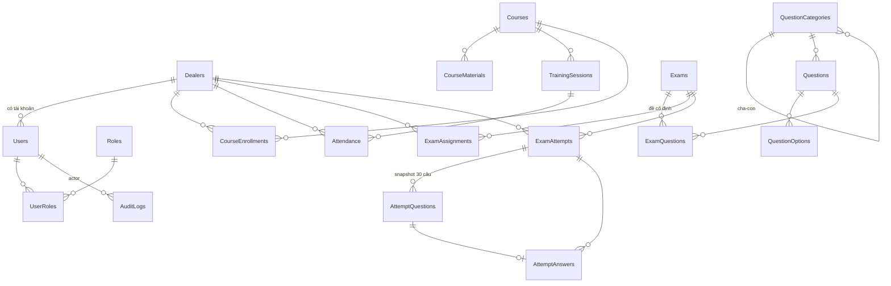

# 04 — Cơ sở dữ liệu (SQL Server)

Nguồn: `schema.sql` (starter v1.0) + mục 6 của spec. Tài liệu này liệt kê mô hình, **các lỗ hổng của schema so với spec**, bảng còn thiếu và script bổ sung đề xuất.

> Khi code, nguồn chân lý là `prisma/schema.prisma` (stack theo TrackMyGoal, xem [10](10-cong-nghe.md)). SQL trong file này viết bằng T-SQL để đối chiếu trực tiếp với `schema.sql` gốc; dùng nó làm đặc tả để viết model Prisma. Hai index có điều kiện ở mục 5 phải tạo bằng SQL trong file migration. Nếu chốt Postgres, đổi cú pháp theo bảng đối chiếu ở [10 §6](10-cong-nghe.md#6-database-và-hosting--cần-chốt).

## 1. Sơ đồ quan hệ (schema hiện có)



## 2. Lỗ hổng so với spec

Xếp theo mức độ ảnh hưởng.

| # | Mức | Vấn đề | Hậu quả | Đề xuất |
|---|---|---|---|---|
| 1 | **Nghiêm trọng** | EX-03 yêu cầu unique (ExamId, DealerId) cho lượt chính thức, nhưng `ExamAttempts` chỉ có index **không unique** `IX_ExamAttempts_DealerExam` | 2 request "Bắt đầu thi" đồng thời (2 tab, double-click, retry) tạo 2 attempt → vi phạm luật 1 lượt | Filtered unique index loại trừ `Voided` (mục 5) |
| 2 | **Nghiêm trọng** | Spec ghi "1 lượt / **tài khoản** / kỳ thi" nhưng EX-03 và schema khóa theo **DealerId**; `ExamAttempts` không có `UserId` | Nếu một đại lý có nhiều tài khoản, không biết ai thi; nếu khóa theo user thì đại lý thi được nhiều lần | `CẦN CHỐT`. Đề xuất: thêm `UserId` để truy vết; unique theo cái nghiệp vụ chốt |
| 3 | Cao | `Exams.ExamType` có `Practice`, nhưng nếu ôn tập cũng ghi vào `ExamAttempts` thì unique index ở #1 chặn làm lại | Mâu thuẫn "ôn tập không giới hạn" | Ôn tập dùng bảng riêng `PracticeSessions`/`PracticeAnswers` **và** thêm cột `IsOfficial` vào `ExamAttempts`, index lọc theo `IsOfficial = 1` |
| 4 | Cao | Bảng `Users` không có `PasswordHash` (spec ghi "PasswordHash/IdentitySubject") | Không đăng nhập được | Theo TrackMyGoal: thêm `PasswordHash` (bcrypt) và `MustChangePassword`; bỏ `IdentitySubject`. Chỉ có 2 vai trò cố định → thay `Roles/UserRoles` bằng cột `Role` (`admin`/`dealer`) có `CHECK`, đưa vào JWT |
| 5 | Cao | Thiếu `ImportJobs` / `ImportErrors` (có trong spec mục 6) | Không làm được UI-12, không tải được file lỗi | Bổ sung (mục 5) |
| 6 | Cao | Thiếu bảng ôn tập (`/api/practice/sessions` có trong API) | Không làm được UI-04 | Bổ sung `PracticeSessions`, `PracticeAnswers` |
| 7 | Trung bình | Không có bảng tiến độ học tài liệu, nhưng mockup ④ hiển thị "60%", "30%" và spec UI-03 yêu cầu "tiến độ hoàn thành" | Không tính được % | Bổ sung `MaterialProgress (MaterialId, DealerId hoặc UserId, CompletedAtUtc)` |
| 8 | Trung bình | `TrainingSessions.TrainerUserId` trỏ tới `Users`, nhưng người trình bày **không phải** vai trò đăng nhập; spec mục 6 còn ghi lỗi "Quản trị viênUserId" (lỗi thay thế chữ) | Ép tạo tài khoản cho giảng viên trái với quy ước 2 vai trò | Đổi thành `PresenterName NVARCHAR(200) NULL` |
| 9 | Trung bình | `TrainingSessions` không có `Title`; mockup ⑤ hiển thị tiêu đề buổi | Một khóa nhiều buổi không phân biệt được | Thêm `Title NVARCHAR(250) NOT NULL` |
| 10 | Trung bình | Không ràng buộc "đúng 1 đáp án đúng" cho câu `SingleChoice` | Câu có 0 hoặc 2 đáp án đúng → chấm sai | Filtered unique index `(QuestionId) WHERE IsCorrect = 1` + kiểm tra ≥ 1 đáp án đúng khi Publish |
| 11 | Trung bình | Không kiểm tra `SelectedOptionId` thuộc đúng câu hỏi của `AttemptQuestionId` | Client gửi optionId của câu khác vẫn lưu được | Kiểm tra ở backend dựa trên snapshot (DB không biểu diễn được gọn) |
| 12 | Trung bình | `ExamAssignments` chỉ theo `DealerId`; spec nói "DealerId hoặc DealerGroupId", mockup/khảo sát có lọc theo khu vực | Giao kỳ thi cho 850 đại lý phải chọn từng người | `CẦN CHỐT` nhóm đại lý. MVP: giao theo khu vực bằng cách bung thành danh sách DealerId lúc lưu |
| 13 | Thấp | Nhiều `DEFAULT`/`CHECK` không đặt tên (Courses, Questions, Exams…) | SQL Server sinh tên ngẫu nhiên → migration khó drop/alter | Prisma migrate tự đặt tên default; `CHECK` phải thêm bằng SQL trong migration và đặt tên rõ ràng |
| 14 | Thấp | Ý nghĩa `Status` không thống nhất: TINYINT ở hầu hết bảng, NVARCHAR ở `ExamAttempts`; giá trị TINYINT chỉ comment ở 2 bảng | Dễ hiểu sai giữa backend/báo cáo | Chốt bảng giá trị ở mục 4; thêm `CHECK` |
| 15 | Thấp | `AuditLogs` "append-only" chỉ là quy ước | Có thể bị sửa/xóa | `DENY UPDATE, DELETE ON dbo.AuditLogs TO <app_role>` |
| 16 | Thấp | `CourseMaterials.FileUrl` lưu URL | URL công khai lộ tài liệu nội bộ | Lưu object key; API sinh signed URL có hạn |
| 17 | Thấp | Không có cơ chế chống ghi đè cho bảng admin hay sửa (Exams, Questions, Courses, Dealers) | 2 admin sửa cùng lúc ghi đè nhau | Dùng `updatedAt` làm phiên bản: `updateMany({ where: { id, updatedAt: <giá trị lúc mở form> } })`, `count = 0` → báo `CONCURRENCY_CONFLICT` |

## 3. Quy ước chung

- Khóa chính: theo quy ước TrackMyGoal, **mọi ID là `UNIQUEIDENTIFIER DEFAULT NEWSEQUENTIALID()`** (Prisma: `String @id @db.UniqueIdentifier @default(dbgenerated("NEWSEQUENTIALID()"))`), thay cho `BIGINT IDENTITY` trong `schema.sql`. Lợi ích phụ: URL `/attempts/{id}` khó đoán. Vẫn **bắt buộc** kiểm tra quyền sở hữu ở mọi request. Script ở mục 5 giữ `BIGINT` cho khớp `schema.sql` gốc; khi viết model Prisma thì đổi sang UUID đồng loạt.
- Quan hệ có nhiều đường khóa ngoại (ví dụ `AttemptAnswers` → `ExamAttempts` trực tiếp và qua `AttemptQuestions`): SQL Server bắt buộc `onDelete: NoAction, onUpdate: NoAction`.
- Thời gian: `DATETIME2(3)`, hậu tố `Utc`, mặc định `SYSUTCDATETIME()`.
- Không xóa cứng dữ liệu nghiệp vụ đã phát sinh liên kết (câu hỏi đã dùng trong attempt, đại lý đã thi). Dùng `Status = Archived/Locked`.
- Collation: `Vietnamese_100_CI_AI` (hoặc `Latin1_General_100_CI_AI_SC_UTF8`) để tìm kiếm tiếng Việt không dấu. `CẦN CHỐT` trước khi tạo DB.

## 4. Bảng giá trị trạng thái (đề xuất)

| Bảng.Cột | Giá trị |
|---|---|
| `Dealers.Status`, `Users.Status` | 0 Locked, 1 Active |
| `Courses.Status`, `Questions.Status` | 0 Draft, 1 Published, 2 Archived |
| `Exams.Status` | 0 Draft, 1 Published (đã mở theo lịch), 2 Closed, 3 Archived |
| `TrainingSessions.Status` | 0 Cancelled, 1 Scheduled, 2 Completed |
| `CourseEnrollments.Status` | 1 Enrolled, 2 Completed, 3 Removed |
| `ExamAttempts.Status` | `InProgress`, `Submitted`, `Expired`, `Voided` |
| `Exams.ShowScorePolicy` | `AfterSubmit`, `AfterExamEnds`, `Never` |
| `Exams.ShowAnswerPolicy` | `AfterSubmit`, `AfterExam`, `Never` |
| `Questions.Difficulty` | 1 Dễ, 2 Trung bình, 3 Khó |
| `ImportJobs.Status` | `Previewed`, `Committing`, `Committed`, `Failed`, `Expired` |

## 5. Script bổ sung đề xuất

Đặc tả bổ sung so với `schema.sql`. Khi code: các bảng/cột thành model trong `schema.prisma`; riêng hai `CREATE UNIQUE INDEX ... WHERE` chép vào file migration của Prisma.

```sql
ALTER TABLE dbo.ExamAttempts ADD
    UserId BIGINT NULL CONSTRAINT FK_ExamAttempts_Users REFERENCES dbo.Users(UserId),
    IsOfficial BIT NOT NULL CONSTRAINT DF_ExamAttempts_IsOfficial DEFAULT (1);
GO

CREATE UNIQUE INDEX UX_ExamAttempts_OneOfficial
    ON dbo.ExamAttempts(ExamId, DealerId)
    WHERE IsOfficial = 1 AND Status <> N'Voided';
GO

CREATE UNIQUE INDEX UX_QuestionOptions_OneCorrect
    ON dbo.QuestionOptions(QuestionId)
    WHERE IsCorrect = 1;
GO

ALTER TABLE dbo.TrainingSessions ADD
    Title NVARCHAR(250) NULL,
    PresenterName NVARCHAR(200) NULL;
GO

CREATE INDEX IX_TrainingSessions_StartsAt ON dbo.TrainingSessions(StartsAtUtc) INCLUDE (CourseId, EndsAtUtc, Status);
GO

CREATE TABLE dbo.ImportJobs (
    ImportJobId BIGINT IDENTITY(1,1) NOT NULL CONSTRAINT PK_ImportJobs PRIMARY KEY,
    UploadedByUserId BIGINT NOT NULL CONSTRAINT FK_ImportJobs_Users REFERENCES dbo.Users(UserId),
    FileName NVARCHAR(260) NOT NULL,
    FileObjectKey NVARCHAR(500) NULL,
    Status NVARCHAR(20) NOT NULL CONSTRAINT DF_ImportJobs_Status DEFAULT (N'Previewed'),
    TotalRows INT NOT NULL CONSTRAINT DF_ImportJobs_Total DEFAULT (0),
    SuccessRows INT NOT NULL CONSTRAINT DF_ImportJobs_Success DEFAULT (0),
    ErrorRows INT NOT NULL CONSTRAINT DF_ImportJobs_Error DEFAULT (0),
    CreatedAtUtc DATETIME2(3) NOT NULL CONSTRAINT DF_ImportJobs_Created DEFAULT SYSUTCDATETIME(),
    CommittedAtUtc DATETIME2(3) NULL,
    ExpiresAtUtc DATETIME2(3) NOT NULL,
    CONSTRAINT CK_ImportJobs_Status CHECK (Status IN (N'Previewed', N'Committing', N'Committed', N'Failed', N'Expired'))
);

CREATE TABLE dbo.ImportRows (
    ImportRowId BIGINT IDENTITY(1,1) NOT NULL CONSTRAINT PK_ImportRows PRIMARY KEY,
    ImportJobId BIGINT NOT NULL CONSTRAINT FK_ImportRows_Jobs REFERENCES dbo.ImportJobs(ImportJobId),
    RowNumber INT NOT NULL,
    PayloadJson NVARCHAR(MAX) NOT NULL,
    IsValid BIT NOT NULL,
    CONSTRAINT UQ_ImportRows UNIQUE (ImportJobId, RowNumber)
);

CREATE TABLE dbo.ImportErrors (
    ErrorId BIGINT IDENTITY(1,1) NOT NULL CONSTRAINT PK_ImportErrors PRIMARY KEY,
    ImportJobId BIGINT NOT NULL CONSTRAINT FK_ImportErrors_Jobs REFERENCES dbo.ImportJobs(ImportJobId),
    RowNumber INT NOT NULL,
    ColumnName NVARCHAR(100) NULL,
    ErrorCode NVARCHAR(50) NOT NULL,
    ErrorText NVARCHAR(500) NOT NULL
);
CREATE INDEX IX_ImportErrors_Job ON dbo.ImportErrors(ImportJobId, RowNumber);
GO

CREATE TABLE dbo.PracticeSessions (
    PracticeSessionId BIGINT IDENTITY(1,1) NOT NULL CONSTRAINT PK_PracticeSessions PRIMARY KEY,
    UserId BIGINT NOT NULL CONSTRAINT FK_PracticeSessions_Users REFERENCES dbo.Users(UserId),
    DealerId BIGINT NOT NULL CONSTRAINT FK_PracticeSessions_Dealers REFERENCES dbo.Dealers(DealerId),
    CategoryId BIGINT NULL CONSTRAINT FK_PracticeSessions_Category REFERENCES dbo.QuestionCategories(CategoryId),
    QuestionCount INT NOT NULL,
    CorrectCount INT NOT NULL CONSTRAINT DF_PracticeSessions_Correct DEFAULT (0),
    StartedAtUtc DATETIME2(3) NOT NULL CONSTRAINT DF_PracticeSessions_Started DEFAULT SYSUTCDATETIME(),
    FinishedAtUtc DATETIME2(3) NULL
);
CREATE INDEX IX_PracticeSessions_User ON dbo.PracticeSessions(UserId, StartedAtUtc DESC);

CREATE TABLE dbo.PracticeAnswers (
    PracticeAnswerId BIGINT IDENTITY(1,1) NOT NULL CONSTRAINT PK_PracticeAnswers PRIMARY KEY,
    PracticeSessionId BIGINT NOT NULL CONSTRAINT FK_PracticeAnswers_Sessions REFERENCES dbo.PracticeSessions(PracticeSessionId),
    QuestionId BIGINT NOT NULL CONSTRAINT FK_PracticeAnswers_Questions REFERENCES dbo.Questions(QuestionId),
    SortOrder INT NOT NULL,
    SelectedOptionId BIGINT NULL CONSTRAINT FK_PracticeAnswers_Option REFERENCES dbo.QuestionOptions(OptionId),
    IsCorrect BIT NULL,
    AnsweredAtUtc DATETIME2(3) NULL,
    CONSTRAINT UQ_PracticeAnswers UNIQUE (PracticeSessionId, QuestionId)
);
GO

CREATE TABLE dbo.MaterialProgress (
    MaterialId BIGINT NOT NULL CONSTRAINT FK_MaterialProgress_Materials REFERENCES dbo.CourseMaterials(MaterialId),
    DealerId BIGINT NOT NULL CONSTRAINT FK_MaterialProgress_Dealers REFERENCES dbo.Dealers(DealerId),
    FirstViewedAtUtc DATETIME2(3) NOT NULL CONSTRAINT DF_MaterialProgress_Viewed DEFAULT SYSUTCDATETIME(),
    CompletedAtUtc DATETIME2(3) NULL,
    CONSTRAINT PK_MaterialProgress PRIMARY KEY (MaterialId, DealerId)
);
GO
```

Ghi chú về script:

- `ImportRows` không có trong spec, được thêm để bước **commit** dùng đúng dữ liệu đã preview (không bắt admin upload lại file, không parse lại file có thể đã bị đổi). Dọn dẹp theo `ExpiresAtUtc` (đề xuất 24 giờ) để không giữ dữ liệu cá nhân quá lâu.
- `ExamAttempts.UserId` để `NULL` cho tương thích dữ liệu cũ; khi chốt nghiệp vụ nên đổi `NOT NULL`.
- Bảng `Users` cần thêm `PasswordHash NVARCHAR(255) NULL`, `MustChangePassword BIT NOT NULL DEFAULT 0`, `Role NVARCHAR(20) NOT NULL` với `CHECK (Role IN (N'admin', N'dealer'))` (#4).

## 6. Index cho các truy vấn nóng

| Truy vấn | Tần suất khi thi | Index |
|---|---|---|
| Lấy attempt theo id + kiểm tra chủ sở hữu | Mỗi request thi | PK `AttemptId` |
| Upsert câu trả lời | ~1 lần / dealer / 30–90 s | `UQ_AttemptAnswers_AttemptQuestion` |
| Tìm attempt hiện có khi bắt đầu thi | 1 lần / dealer | `UX_ExamAttempts_OneOfficial` |
| Worker quét attempt hết giờ | 2–4 lần / phút | `IX_ExamAttempts_Deadline (DeadlineAtUtc, Status)` — nên đổi thành filtered `WHERE Status = N'InProgress'` |
| Kiểm tra dealer được giao kỳ thi | 1 lần / dealer | `UQ_ExamAssignments (ExamId, DealerId)` |
| Báo cáo theo kỳ thi | Thấp | `IX_ExamAttempts_ExamStatus` + `INCLUDE (ScorePercent, IsPassed, DealerId)` |

## 7. Lưu trữ và dung lượng (ước lượng)

- Mỗi attempt: 1 dòng `ExamAttempts` + 30 dòng `AttemptQuestions` (snapshot ~1–2 KB) + ≤ 30 dòng `AttemptAnswers` ≈ 60 KB.
- 1.000 dealer × 10 kỳ thi/năm ≈ 600 MB/năm. Không cần partition ở MVP.
- `CẦN CHỐT` thời hạn lưu hồ sơ thi, log và file import (spec mục 8).

## 8. Hiện thực (prisma/schema.prisma) — khác biệt so với đặc tả gốc

Nguồn chân lý khi code là `prisma/schema.prisma`. Tên bảng/cột trong DB dùng `snake_case` (`exam_attempts.slot_key`…), tên trong Prisma dùng `camelCase`.

| Hạng mục | Đặc tả / `schema.sql` | Hiện thực | Lý do |
|---|---|---|---|
| Khóa chính | `BIGINT IDENTITY` | `UNIQUEIDENTIFIER DEFAULT NEWSEQUENTIALID()` cho mọi bảng | Quy ước TrackMyGoal; URL khó đoán |
| Vai trò | `Roles` + `UserRoles` | Cột `users.role` (`admin` / `dealer`) | Chỉ có 2 vai trò cố định, đưa thẳng vào JWT |
| Mật khẩu | Thiếu cột | `password_hash` (bcrypt), `must_change_password`, `failed_login_count`, `locked_until` | Đăng nhập Credentials + khóa tạm sau 5 lần sai |
| Luật 1 lượt (EX-03) | Filtered unique index | `exam_attempts.slot_key` UNIQUE; lượt bị hủy đổi khóa thành `…:void:<attemptId>` | Prisma biểu diễn được, chạy trên cả SQL Server và Postgres |
| Phân biệt thi chính thức / ôn tập | Cột `IsOfficial` | Không cần: `exam_attempts` chỉ chứa thi chính thức; ôn tập ở `practice_sessions` / `practice_answers` | Đơn giản hơn |
| Trạng thái | `TINYINT` | Chuỗi (bảng giá trị ở `CLAUDE.md`) | Dễ đọc, khớp JSON API |
| Điểm | `Score DECIMAL`, `ScorePercent DECIMAL` | `correct_count INT`, `score_percent FLOAT` (làm tròn 2 chữ số), `pass_mark_percent INT` | Tránh convert Decimal ở Next.js |
| Snapshot câu hỏi | `SnapshotJson` | `attempt_questions.snapshot` (JSON gồm thứ tự lựa chọn đã trộn + đáp án đúng) | Như đặc tả |
| Đáp án đã chọn | FK tới `QuestionOptions` | `attempt_answers.selected_option_id` **không** FK; kiểm tra thuộc snapshot ở engine | Cho phép sửa/xóa lựa chọn của câu hỏi mà không phá lịch sử thi |
| Khóa dòng khi lưu đáp án | — | `exam_attempts.last_activity_at` | Mỗi lần lưu cập nhật cột này để khóa dòng attempt, tuần tự hóa lưu và nộp bài |
| Cấp lại lượt | `ReissueReason` | `void_reason`, `void_reason_category`, `voided_at`, `voided_by_id` | Phân loại sự cố (Q12) |
| Lỗi import | `ImportErrors` | `import_rows.errors` (JSON) + `import_rows.payload` | Commit dùng đúng dữ liệu đã preview; payload hợp lệ bị xóa sau commit |
| Đề thi | `ExamQuestions` cố định | `exam_questions` là **bộ câu hỏi (pool)**; `exams.selection_mode` = `fixed` / `random`; `exams.shuffle_options` | Một cấu trúc cho cả đề cố định và ngẫu nhiên |
| Lịch training | `TrainerUserId` | `title`, `presenter_name` | Người trình bày không phải vai trò đăng nhập |
| Tài liệu | `FileUrl` | `kind` (`link`/`file`), `url`, `storage_key`, `file_name`, `content_type` | File lưu ngoài `public/`, tải qua route có kiểm tra quyền |
| Tiến độ học | Không có | `material_progress` (xem / hoàn thành) | Mockup ④ hiển thị % tiến độ |
| Điểm danh | `Attendance` | `attendances.source = 'click'` khi đại lý bấm "Tham gia" | Điểm danh thủ công/tự động từ Meet để sau (Q8) |
| Nhóm đại lý | `DealerGroupId` | Giao theo **khu vực** hoặc danh sách mã (bung thành từng `dealer_id`) | Q5 |
| Collation | — | DB tạo với `Vietnamese_100_CI_AI` | Tìm kiếm tiếng Việt không dấu, không phân biệt hoa thường |
| Thông báo | Không có trong đặc tả | `notifications` (`user_id`, `type`, `title`, `body`, `link`, `dedupe_key`, `read_at`), UNIQUE (`user_id`, `dedupe_key`) | Chuông thông báo; `dedupe_key` chống gửi trùng khi admin bấm lại hoặc khi nhắc việc được sinh lại mỗi lần tải |
| Công khai xếp hạng | Không có | `exams.show_leaderboard BIT DEFAULT 0` | Admin quyết định đại lý có xem top 10 hay chỉ xem hạng của mình |
